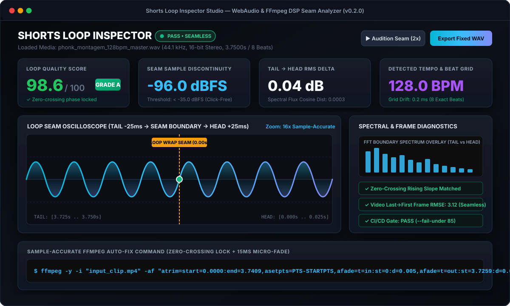

# 🎛️ Shorts Loop Inspector (`shorts-loop-inspector`)

<p align="center">
  
</p>

<p align="center">
  <a href="https://newzwalker.github.io/musical-octo-garbanzo/web/index.html"></a>
  <a href="LICENSE"></a>
  <a href="https://www.python.org/"></a>
  
</p>

**Deterministic audio/video seamless loop analyzer, zero-crossing discontinuity detector, and beat-locked trim calculator for short-form media pipelines (YouTube Shorts, TikTok, Reels, and DAW/game audio loops).**

---

## ✨ Key Features

| Module | What It Solves | Output Metric |
| :--- | :--- | :--- |
| **Seam Click/Pop Detector** | Detects sample-level wrap-around discontinuity between the final sample and sample `0` | `Boundary Jump (dBFS)` |
| **Loudness Continuity Audit** | Measures loudness step between the last 50ms tail and first 50ms head | `Tail → Head RMS Delta (dB)` |
| **FFT Spectral Seam Distance** | Detects timbral/filter jumps across the loop cut using Hanning-windowed FFT cosine similarity | `Spectral Flux Distance` |
| **Phase-Locked Zero-Crossing Finder** | Locates rising zero-crossings near clip boundaries to eliminate clicks without altering pitch | `start_sec` / `end_sec` |
| **BPM & Beat-Grid Drift** | Onset-envelope autocorrelation tempo estimator with parabolic sub-sample interpolation | `BPM` & `Drift (ms)` |
| **Video Frame Seam Check** | Computes RGB root-mean-square error (`RMSE`) between the last and first video frames | `Video RMSE` |
| **One-Line FFmpeg Auto-Fix** | Synthesizes a ready-to-run `atrim` + 15ms micro-crossfade command | `ffmpeg_fix_command` |

---

## 🖥️ Studio Web Inspector (`web/index.html`)

Open [`web/index.html`](web/index.html) directly in any browser (or enable **GitHub Pages** to use it online) for a 100% client-side **WebAudio Studio Oscilloscope**:
* **16x Sample-Accurate Seam Zoom**: Inspect the exact wrap-around boundary (`-25ms Tail → 0.00s Seam → +25ms Head`).
* **Real-Time Seam Audition (`▶ Audition Seam 2x`)**: Listen to the loop transition directly in the browser.
* **Built-In Synthetic Test Generators**: Compare a **Grade-A Seamless Loop** against a **Glitched Cut** in one click.

---

## 🚀 Quick Start (CLI & Python SDK)

### Installation

```bash
git clone https://github.com/newzwalker/musical-octo-garbanzo.git
cd musical-octo-garbanzo
pip install -e ".[dev]"
```

### Run the Built-In Demo

```bash
shorts-loop-inspector --generate-demo ./demo_loops
```

```text
====================================================================
 Shorts Loop Inspector v0.2.0 | PASS (SEAMLESS)
====================================================================
 File              : demo_loops/seamless_128bpm.wav
 Duration / SR     : 3.7500s @ 44100 Hz (1 ch)
 Loop Quality Score: 98.6 / 100.0  [Grade: A]
 Boundary Jump     : -96.00 dBFS
 Tail/Head RMS Diff: 0.00 dB
 Spectral Distance : 0.0000
 Optimal Zero-Cross: start=0.0000s, end=3.7409s
--------------------------------------------------------------------
 Recommended FFmpeg Auto-Fix:
  ffmpeg -y -i "demo_loops/seamless_128bpm.wav" -af "atrim=start=0.0:end=3.7409,asetpts=PTS-STARTPTS,afade=t=in:st=0:d=0.005,afade=t=out:st=3.7259:d=0.015" "fixed_loop.wav"
====================================================================
```

### Inspect Any Audio or Video File

```bash
# Terminal QA report
shorts-loop-inspector my_short_clip.mp4

# Machine-readable JSON output for automated rendering pipelines
shorts-loop-inspector my_loop.wav --json

# CI/CD Quality Gate (exits with code 1 if score < 85)
shorts-loop-inspector my_loop.wav --fail-under 85
```

---

## 🧪 Running Tests

```bash
python tests/test_analyzer.py
```

## 📄 License

MIT © [Newz Walker](https://github.com/newzwalker)
